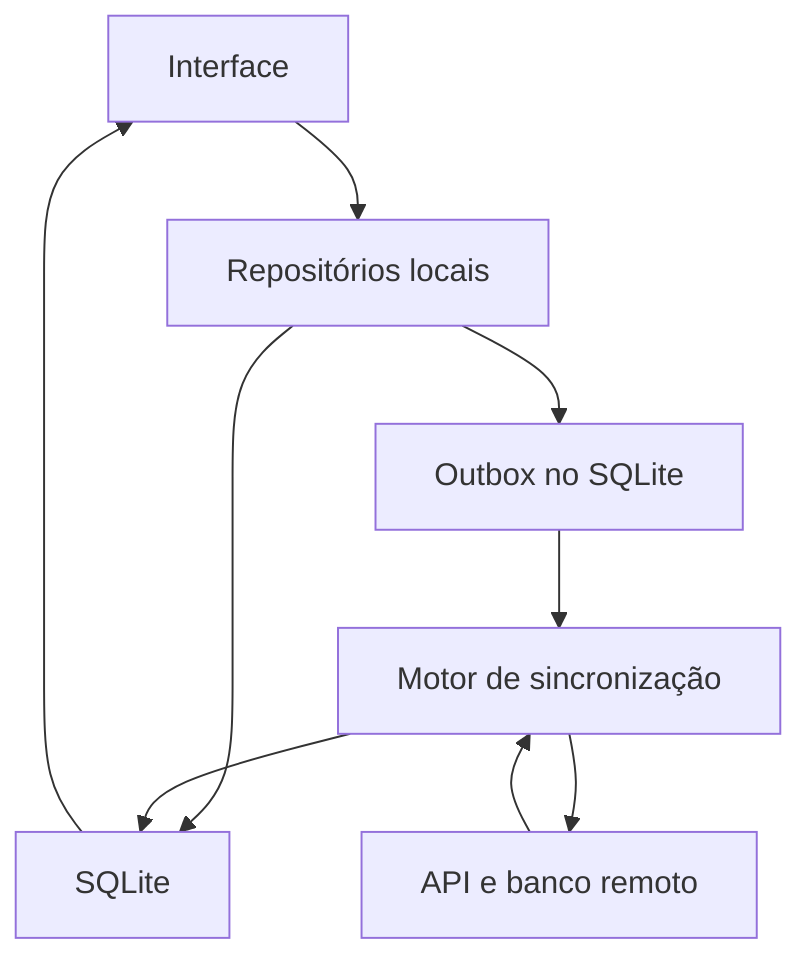

# 01 - Offline-first

[Índice e convenções](README.md) · [Checklist](06-checklist-de-revisao.md)

## 1. Origem e objetivo

Fonte principal: **S0 - `offline-first-expo.pdf`**.

| Páginas | Conteúdo adaptado |
| --- | --- |
| 3-7 | Conceito, comparação com cache, escopo e arquitetura |
| 8-16 | SQLite, ORM, Drizzle, reatividade, migrations e transações |
| 18-23 | Modelo de sync, outbox, cursor, conflitos e tombstones |
| 25-32 | Dados estruturados, geolocalização, imagens e vídeos |
| 33-36 | Gatilhos, ferramentas, boas práticas e síntese |

Objetivo: permitir que o agente avalie se o Enlace preserva o trabalho local e sincroniza sem perda silenciosa, duplicação ou dependência desnecessária da rede.

## 2. Conceito e arquitetura

**Aula.** No offline-first, o banco local alimenta a interface. O usuário lê e grava no dispositivo; um motor de sincronização reconcilia o estado com o servidor. A interface não espera uma requisição remota para confirmar que o rascunho foi salvo localmente.

O servidor continua responsável pela validação e autorização remotas. “Salvo no aparelho” e “publicado no servidor” são estados diferentes.

| Aspecto | Cache | Offline-first |
| --- | --- | --- |
| Papel local | Cópia para acelerar leitura | Base operacional da interface |
| Sem rede | Lê o que foi armazenado | Lê e altera o conjunto local disponível |
| Escrita | Geralmente exige rede | Persiste local e envia depois |
| Atualização | TTL e invalidação | Reconciliação entre réplicas |
| Conflitos | Frequentemente delegados ao servidor | Precisam de política explícita |

O material apresenta a organização UI, repositórios, SQLite, motor de sync e API. O desenho abaixo é uma **aplicação conceitual**, sem impor nomes de diretórios:



A gravação do dado e de sua pendência é atômica dentro do SQLite. O motor de sincronização não deve manter uma segunda cópia de estado que contradiga o banco exibido pela UI.

## 3. Banco local, ORM e migrations

**Aula.** `expo-sqlite` fornece SQLite real, persistido em arquivo no dispositivo.

| Recurso citado | Papel |
| --- | --- |
| `openDatabaseSync` / `openDatabaseAsync` | Abrir o banco |
| `execAsync` | Executar SQL de inicialização e outros comandos |
| `runAsync` | Executar mutações com parâmetros |
| `getAllAsync` | Ler conjuntos de registros |
| `withTransactionAsync` | Agrupar operações atomicamente |
| WAL | Favorecer leitura concorrente à escrita |
| Listener de mudanças | Base para consultas reativas |
| SQLCipher | Opção de criptografia citada, dependente da configuração/build |

WAL não substitui transações nem resolve conflitos de negócio. A disponibilidade e a semântica exata das APIs devem ser conferidas nas versões instaladas.

O ORM acrescenta tipagem, produtividade e apoio à evolução do schema. O Drizzle define tabelas em TypeScript, infere tipos de insert/select e oferece um query builder próximo ao SQL. SQL direto também é uma opção válida.

No fluxo dos slides:

1. Alterar o schema em TypeScript.
2. Gerar migrations com `drizzle-kit generate`.
3. Incluir os arquivos SQL no bundle conforme a configuração do projeto.
4. Aplicar com `useMigrations` na abertura.
5. Liberar telas dependentes apenas após sucesso; apresentar falha se a migração não concluir.

`useLiveQuery` reexecuta a consulta quando há mudanças observáveis no banco, com o listener habilitado no exemplo. Isso permite que escritas do sync atualizem a tela. Uma alternativa sem Drizzle deve oferecer atualização equivalente da UI; não é obrigatório usar esse hook.

**Drizzle não fornece sozinho um motor completo de sincronização.** A aula também menciona TypeORM, WatermelonDB, Kysely, SQL direto e Prisma como comparação de alternativas. Suas classificações de suporte refletem o material da aula e não devem ser usadas como diagnóstico atualizado de compatibilidade. Não trocar a tecnologia existente sem necessidade demonstrada.

## 4. Regras verificáveis

### OFF-01 - Definir o contrato offline e usar persistência local

**Aula:** S0, pp. 3-7. **Aplicação ao Enlace:** criar/editar rascunhos e consultar dados locais não deve depender de uma chamada remota bem-sucedida, quando essas operações estiverem no escopo offline.

Documentar quais operações funcionam offline e quais exigem confirmação remota. Anúncios nunca baixados e imagens não armazenadas não ficam disponíveis por simples uso de SQLite.

**Verificar:** criar e editar em modo avião, fechar e reabrir o aplicativo e confirmar que o trabalho reaparece. Identificar telas que leem diretamente da API ignorando o contrato local.

### OFF-02 - Evoluir o banco sem apagar dados do usuário

**Aula:** S0, pp. 9-16. Inicialização e migrations devem preservar registros existentes. A UI deve receber mudanças feitas pela sincronização.

**Complemento de implementação:** testar a atualização partindo de uma versão anterior com registros e operações pendentes. Não solucionar incompatibilidade apagando o banco. Uma transação não desfaz operações de rede; usar a API transacional realmente suportada pelo driver e evitar copiar callbacks assíncronos sem conferir sua semântica.

**Verificar:** migrations versionadas, tratamento de erro na inicialização, dados preservados e atualização da lista após uma escrita do sync.

### OFF-03 - Usar identidade global e informações de sincronização

**Aula:** S0, pp. 12 e 18. O modelo apresenta os seguintes campos conceituais:

| Campo | Finalidade |
| --- | --- |
| `id` UUID/ULID | Identificar o registro criado offline entre aparelhos |
| `updated_at` | Auxiliar rastreamento de alterações |
| `version` | Detectar atualização concorrente |
| `deleted_at` | Preservar a informação de exclusão |
| `sync_status` | Mostrar pendência, sucesso ou erro |
| `outbox` | Persistir operações a enviar |

Os nomes podem variar. Nem todo recurso precisa de todos os campos se houver mecanismo equivalente documentado. Um contador local pode existir, mas não deve ser confundido com a identidade global.

**Verificar:** dois aparelhos podem criar registros sem colisão; a identidade permanece estável no reenvio e na cópia remota.

### OFF-04 - Persistir dado e operação pendente na mesma transação

**Aula:** S0, pp. 16 e 20. A outbox é uma fila durável de mutações, não apenas um array em memória.

Contrato em pseudocódigo:

```text
transação local:
  salvar a alteração da entidade
  registrar operação pendente com identidade estável
confirmar transação
atualizar a interface a partir do banco
```

Uma falha não pode deixar o dado salvo sem possibilidade de sincronização nem uma operação apontando para uma alteração inexistente.

**Aplicação ao Enlace:** criação de anúncio e fotos relacionadas têm dependências. Sincronizar o pai antes dos filhos que precisam de sua referência, conforme o contrato escolhido.

**Verificar:** interromper a gravação e reiniciar; o estado deve estar completo ou não aplicado. Identificar onde a pendência sobrevive ao encerramento do app.

### OFF-05 - Tornar o envio repetível e idempotente

**Aula:** S0, pp. 19-20 e 35. Um worker lê operações pendentes, envia e só as confirma após sucesso. Falhas transitórias pedem retry com backoff exponencial e jitter. O servidor precisa reconhecer reenvios, por exemplo por chave de idempotência.

**Complemento de implementação:** um timeout pode acontecer depois de o servidor já ter gravado. Reenviar com uma identidade nova duplica dados. A idempotência deve ser aplicada no lado remoto, não apenas com um botão desabilitado no app.

Separar erros transitórios de erros permanentes. Nem todo 4xx é permanente: expiração de autenticação, conflito ou limite de requisições exigem tratamento específico. Não repetir indefinidamente uma operação inválida sem informar o usuário.

**Verificar:** simular confirmação perdida após gravação remota; repetir a operação deve manter um único resultado lógico.

### OFF-06 - Receber alterações incrementalmente sem avançar o cursor cedo

**Aula:** S0, pp. 18-21. Delta sync busca o que mudou desde um cursor. O lote recebido e o próximo cursor devem ser persistidos na mesma transação.

```text
ler cursor atual
buscar lote remoto
transação local:
  reconciliar todos os itens do lote
  salvar próximo cursor
confirmar transação
continuar a paginação se houver mais resultados
```

Utilizar a referência do servidor; não usar o relógio do aparelho como autoridade da ordem remota. Cursor não precisa ser apenas um timestamp.

**Complemento de implementação:** distinguir falha de download, erro ao aplicar o lote e fim da paginação. Não sobrescrever uma edição local pendente só porque chegou uma cópia remota. Aplicar a política de conflito de OFF-07. Se o projeto usa snapshot por ser pequeno, avaliar esse contrato por evidência e justificar a ausência de delta, em vez de impor escala desnecessária.

**Verificar:** erro no meio do lote não avança o cursor; repetir a leitura não perde nem duplica registros.

### OFF-07 - Definir conflitos e preservar edições feitas durante o envio

**Aula:** S0, p. 22. Conflitos são esperados quando mais de um dispositivo altera o mesmo dado.

| Estratégia | Benefício | Limite |
| --- | --- | --- |
| Servidor vence | Simplicidade | Pode descartar edição local |
| Last-write-wins | Regra simples por ordem temporal | Pode perder alterações; exige cuidado com relógios |
| Merge por campo | Preserva mudanças em campos distintos | Exige metadados e regra por campo |
| CRDT | Convergência de estruturas apropriadas | Complexidade e espaço adicionais |
| Decisão do usuário | Evita escolha silenciosa | Exige interação |

**Aplicação ao Enlace:** definir tratamento de alterações concorrentes em descrição, disponibilidade e localização. Uma regra aceitável para um título pode não ser suficiente para marcar um animal como adotado.

**Complemento de implementação:** se a revisão 1 estiver em envio e o usuário criar a revisão 2, confirmar a revisão 1 não pode marcar a revisão 2 como enviada. Correlacionar a confirmação com a operação/revisão realmente enviada. Esse controle pode usar versões, operações distintas ou mecanismo equivalente.

**Verificar:** edição em dois aparelhos e edição local enquanto uma requisição está em andamento.

### OFF-08 - Sincronizar exclusões antes da limpeza definitiva

**Aula:** S0, p. 23. Soft delete preenche `deleted_at`. O tombstone sobe na sincronização e é recebido por outros aparelhos. Consultas de itens ativos filtram `deleted_at IS NULL`.

**Complemento de implementação:** purgar tombstones cedo demais permite que um aparelho antigo ressuscite um registro. Definir retenção e recuperação para clientes que ficaram offline além desse período, como exigir nova carga. Não apagar arquivos ligados a uploads ainda pendentes sem uma decisão explícita.

**Aplicação ao Enlace:** marcar como adotado é uma mudança de estado do anúncio, não automaticamente uma exclusão.

**Verificar:** excluir em um aparelho e sincronizar outro não faz o anúncio reaparecer.

### OFF-09 - Acionar sincronização sem criar execuções concorrentes

**Aula:** S0, pp. 7 e 33; S4, p. 22. Gatilhos incluem reconexão, retorno ao foreground, escrita local e atualização manual. NetInfo indica mudança de conectividade. Tarefas em segundo plano não têm horário garantido.

**Complemento de implementação:** utilizar coordenação efetiva do worker, liberar travas em falhas e não depender exclusivamente de execução em background. Conectado ao Wi-Fi não significa API acessível. Uma trava apenas no componente visual não coordena necessariamente todos os pontos que iniciam sync.

**Verificar:** reconexão e botão manual ao mesmo tempo não duplicam o processamento; um erro não deixa o sync bloqueado para sempre.

### OFF-10 - Tornar o estado de sincronização compreensível

**Aula:** S0, pp. 3 e 18. Mostrar pendente, enviado e erro, ou estados equivalentes.

**Aplicação ao Enlace:** não apresentar “publicado” quando existe apenas um rascunho local. Uma foto ainda não enviada deve ter estado reconhecível sem esconder o anúncio local.

**Verificar:** ausência de rede, falha permanente e nova tentativa produzem mensagens coerentes, preservando o trabalho do usuário.

### OFF-11 - Adequar a sincronização ao tipo de dado

**Aula:** S0, pp. 25-32.

| Tipo | Estratégia da aula | Cuidados |
| --- | --- | --- |
| CRUD | Push por outbox e pull incremental | Conflitos, validação, lotes, pai antes de filho |
| Pontos de GPS imutáveis | Inserção e envio em lotes | Precisão, distância mínima, bateria e instante de captura |
| Imagens | Arquivo separado, compressão e fila de upload | URI local, referência remota, hash quando útil e miniaturas |
| Vídeos | Upload resumível em partes | Offset remoto, Wi-Fi, bateria, quota e limpeza |

**Aplicação ao Enlace:** a localização editável de um anúncio é um campo do anúncio e pode ter conflito. A afirmação de que GPS “não tem conflito” nos slides se refere ao modelo de pontos imutáveis, não a qualquer uso de coordenadas. Não implementar coleta contínua para simplesmente preencher a localização de um anúncio.

Uploads de imagem e vídeo são detalhados em [mídia](04-tratamento-e-armazenamento-de-midia.md) e [integração](05-sqlite-supabase-e-seguranca.md).

**Verificar:** a estratégia corresponde ao dado real e não adiciona rastreamento, permissões ou processamento desnecessários.

## 5. Alternativas ao motor próprio

S0, p. 34, cita PowerSync, ElectricSQL, WatermelonDB e Turso como alternativas com propostas distintas. A lista serve para reconhecer que existe custo de manutenção no sync próprio; não comprova compatibilidade com a versão ou infraestrutura do Enlace.

**Aplicação ao Enlace:** primeiro verificar o mecanismo existente e os requisitos. Adotar uma ferramenta externa é uma decisão de arquitetura, com custo de integração, e não uma correção automática por leitura dos slides.

## 6. Decisões a registrar após a auditoria

- Quais entidades e operações têm garantia offline?
- Qual é a fonte de leitura de cada tela?
- Como identidade, outbox, cursor e confirmação de revisão são representados?
- Qual política resolve conflito de edição e exclusão?
- Como o app recupera falhas e torna as pendências visíveis?
- Como dados locais se vinculam à conta correta? Ver DAT-10 no documento 05.

Registrar respostas com evidências, sem presumir que a arquitetura atual já as satisfaz.
