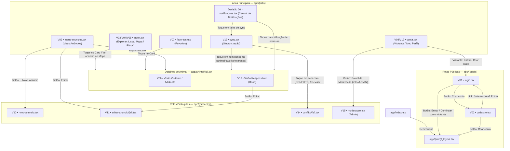
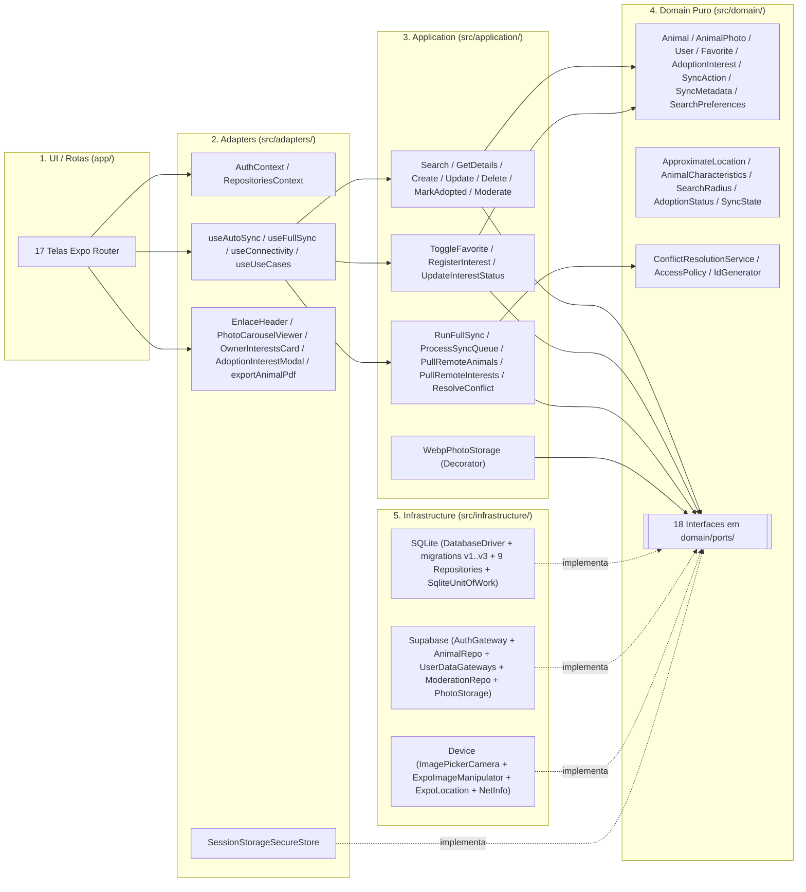
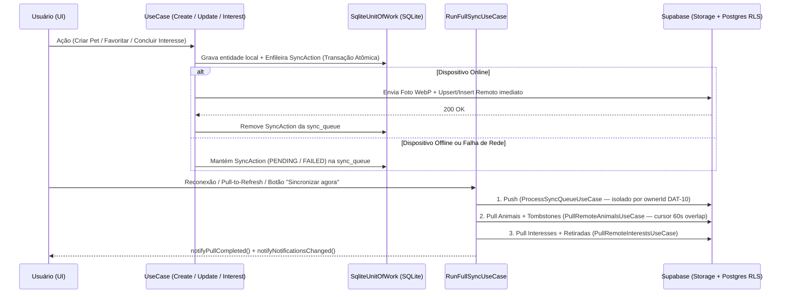

# Grafo de Arquitetura, Navegação e Fluxos — Enlace

Este documento serve como mapa visual e técnico do aplicativo **Enlace — Rede Comunitária de Adoção de Animais**, detalhando a navegação entre telas, a ação de cada botão da interface, o grafo de dependências da Clean Architecture e o ciclo de sincronização offline-first.

---

## 1. Grafo de Navegação e Ações de Botões (`app/`)

---

## 2. Grafo de Dependências em Clean Architecture (`app` → `adapters` → `application` → `domain` ← `infrastructure`)

---

## 3. Grafo do Ciclo de Sincronização Offline-First e Trilha de Adoção

---

## 4. Mapa Completo: Tela → Botões → Casos de Uso → Persistência

| Tela (`app/`) | Botões / Interações | Caso de Uso / Serviço Acionado | Tabelas SQLite / Supabase Afetadas |
|---|---|---|---|
| **V01 • `login.tsx`** | `Entrar`, `Criar conta`, `Continuar como visitante`, `Mostrar/ocultar senha` | `AuthContext.login` → `SupabaseAuthGateway.login` | `users` (SQLite), `auth.users` / `public.users` (Supabase), `SecureStore` |
| **V02 • `cadastro.tsx`** | `Criar conta`, `Já tem conta? Entrar`, `Voltar` | `AuthContext.register` → `SupabaseAuthGateway.register` | `users` (SQLite), `auth.users` / `public.users` (Supabase), `SecureStore` |
| **V03/V04/V05 • `index.tsx`** | `Busca textual`, `Pílula de cidade`, `Botão de filtros`, `Chips Todos/Cães/Gatos`, `Toggle Lista/Mapa`, `Favoritar (♥)`, `Pull-to-Refresh`, `Ver anúncio (Mapa)` | `SearchAnimalsUseCase`, `ToggleFavoriteUseCase`, `SearchPreferencesRepository`, `LocationGateway`, `RunFullSyncUseCase` | `animals`, `animal_photos`, `favorites`, `search_preferences`, `sync_queue` |
| **V06 • `animal/[id].tsx` (Adotante)** | `Voltar`, `Favoritar (♥)`, `Carrossel + Zoom 1x–4x`, `Demonstrar interesse`, `Cancelar meu interesse`, `Gerar PDF do anúncio` | `GetAnimalDetailsUseCase`, `ToggleFavoriteUseCase`, `RegisterAdoptionInterestUseCase.execute / .cancel`, `exportAnimalPdf` | `animals`, `favorites`, `adoption_interests`, `sync_queue` |
| **V16 • `animal/[id].tsx` (Responsável)** | `Editar`, `Marcar como adotado`, `Reabrir para adoção`, `Remover (lixeira)`, `Botões da trilha (Enviada / Em análise / Visita combinada / Concluída / Recusada)`, `Gerar PDF do anúncio` | `MarkAnimalAdoptedUseCase.execute / .reopen`, `DeleteAnimalUseCase`, `UpdateInterestStatusUseCase` (com auto-adoção em `CONCLUIDA`), `exportAnimalPdf` | `animals`, `adoption_interests`, `animal_tombstones`, `sync_queue` |
| **V07 • `favoritos.tsx`** | `Toque no card`, `Remover favorito (♥)`, `Pull-to-Refresh`, `Entrar na minha conta (visitante)` | `ToggleFavoriteUseCase`, `RunFullSyncUseCase` | `favorites`, `animals`, `sync_queue` |
| **V08/V12 • `conta.tsx`** | `Tirar foto`, `Galeria`, `Chips de interesses`, `Salvar alterações`, `Painel de Moderação (Admin)`, `Sair` | `CameraGateway`, `WebpPhotoStorage`, `SupabasePhotoStorage`, `AuthContext.updateProfile / .logout` | `users`, `local_images`, bucket `animal-photos` |
| **V09 • `meus-anuncios.tsx`** | `+ Novo anúncio`, `Toque no card`, `Editar`, `Adotado`, `Reabrir`, `Excluir`, `Pull-to-Refresh` | `MarkAnimalAdoptedUseCase.execute / .reopen`, `DeleteAnimalUseCase`, `RunFullSyncUseCase` | `animals`, `animal_tombstones`, `sync_queue` |
| **V10 • `novo-anuncio.tsx`** | `Câmera`, `Galeria`, `Remover miniatura (x)`, `Chips Espécie/Sexo/Porte`, `Usar minha localização (GPS)`, `Salvar anúncio` | `CameraGateway`, `LocationGateway`, `CreateAnimalUseCase`, `WebpPhotoStorage`, `SqliteUnitOfWork` | `animals`, `animal_photos`, `local_images`, `sync_queue`, bucket `animal-photos` |
| **V11 • `editar-anuncio/[id].tsx`** | `Câmera`, `Galeria`, `Remover miniatura (x)`, `Chips Espécie/Sexo/Porte`, `Usar minha localização (GPS)`, `Salvar alterações` | `CameraGateway`, `LocationGateway`, `UpdateAnimalUseCase`, `WebpPhotoStorage`, `SqliteUnitOfWork` | `animals`, `animal_photos`, `local_images`, `sync_queue`, bucket `animal-photos` |
| **V13 • `sync.tsx`** | `Sincronizar agora`, `Pull-to-Refresh`, `Toque no item da fila`, `Revisar conflito` | `RunFullSyncUseCase` (`ProcessSyncQueueUseCase` + `PullRemoteAnimalsUseCase` + `PullRemoteInterestsUseCase`) | `sync_queue`, `sync_metadata`, `animals`, `favorites`, `adoption_interests` |
| **V14 • `conflito/[id].tsx`** | `Manter minha edição`, `Usar versão online` | `ResolveSyncConflictUseCase`, `RunFullSyncUseCase` | `animals`, `sync_queue` |
| **V15 • `moderacao.tsx`** | `Ocultar`, `Reexibir` | `ModerateAnimalUseCase` (`AccessPolicy.canModerate`) | `animals` (`moderation_status`), `animal_tombstones` |
| **Decisão 20 • `notificacoes.tsx`** | `Toque no item do feed`, `Pull-to-Refresh` | `AppStateRepository` (`notifications_last_seen`), `RunFullSyncUseCase` | `app_state`, `adoption_interests`, `sync_queue` |
